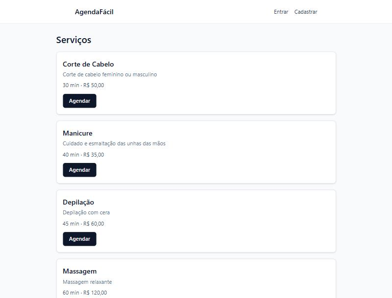
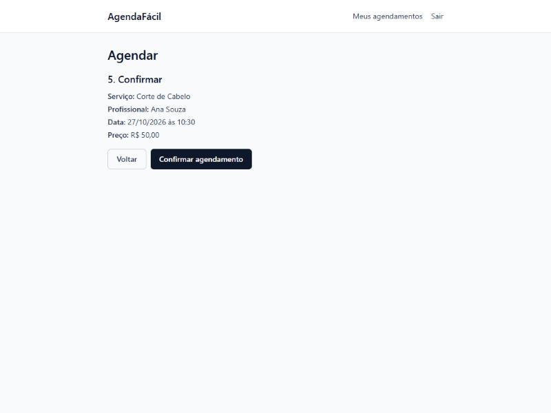
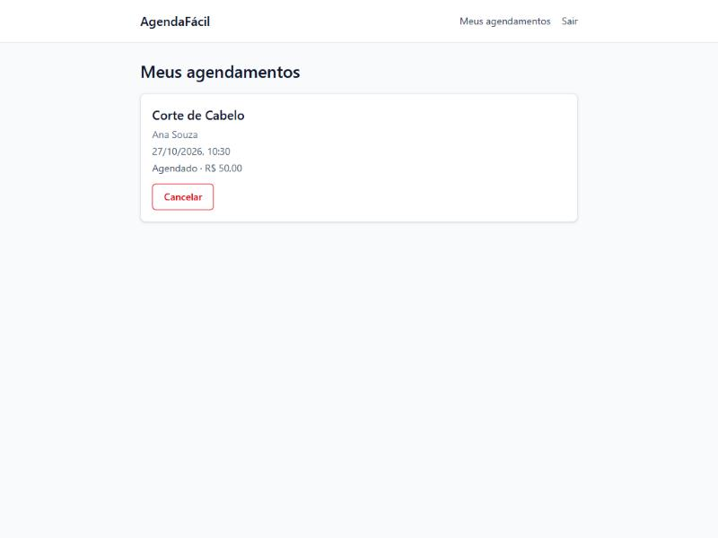
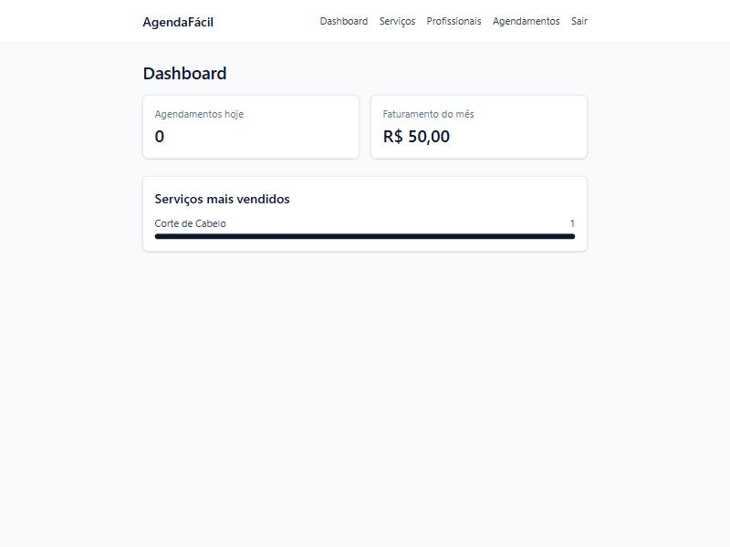
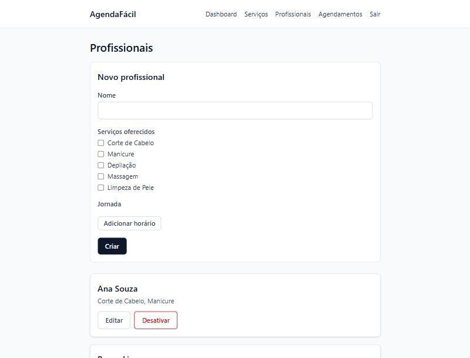
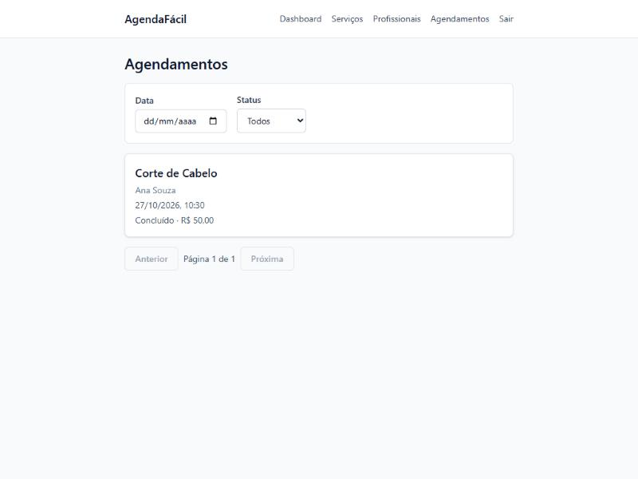
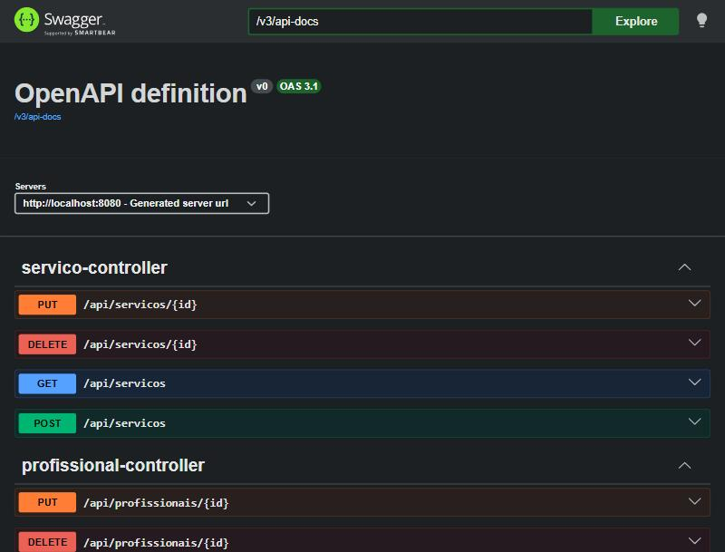
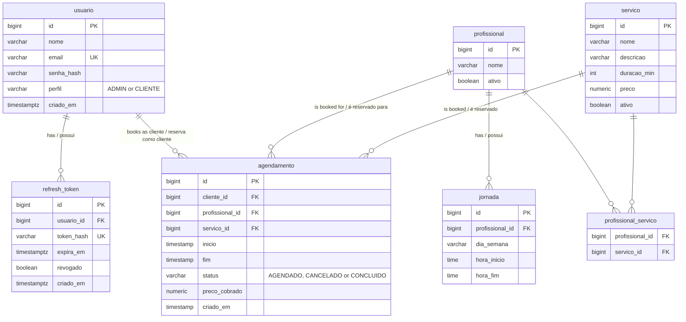

# AgendaFácil

Full-stack scheduling system for salons and clinics, with a customer booking flow and an admin panel — built with Spring Boot and React.
Sistema full-stack de agendamentos para salões e clínicas, com fluxo de reserva para clientes e painel administrativo — construído com Spring Boot e React.

🇬🇧 [Jump to English](#english) · 🇧🇷 [Ir para Português](#português)

---

## Screenshots

| Services (public) | Booking flow | My bookings |
|---|---|---|
|  |  |  |

| Admin dashboard | Admin — professionals | Admin — bookings |
|---|---|---|
|  |  |  |

| Swagger / OpenAPI |
|---|
|  |

## Database schema / Esquema do banco de dados



`agendamento` also has a generated `tsrange` column and a Postgres **exclusion constraint** (`EXCLUDE USING gist`) that makes it physically impossible for two `AGENDADO` rows to overlap for the same professional — enforced by the database itself, not just application code.
A tabela `agendamento` também tem uma coluna `tsrange` gerada e uma **constraint de exclusão** do Postgres (`EXCLUDE USING gist`) que torna fisicamente impossível dois registros `AGENDADO` se sobreporem para o mesmo profissional — garantido pelo próprio banco, não apenas pela aplicação.

---

<a id="english"></a>

## 🇬🇧 English

### Overview

AgendaFácil is a complete booking system: visitors browse services with no login, register and book a time slot through a guided 4-step flow, and manage their own bookings. Admins get a dashboard (today's bookings, monthly revenue, top services), full CRUD over services and professionals (including weekly working-hours editing), and a filterable, paginated view of every booking in the system.

### Features

- JWT authentication (access + refresh tokens), BCrypt password hashing, role-based access (`ADMIN` / `CLIENTE`)
- Real-time availability calculation respecting each professional's working hours, service duration, and existing bookings
- A booking flow that is **provably safe against double-booking**, even under concurrent requests — guaranteed at the database level, not just checked in application code
- Cancellation (up to 2 hours before the appointment) and admin-side completion
- Admin dashboard with aggregate stats and a lightweight bar chart (no charting library)
- Full CRUD for services and professionals, including a repeatable weekly-schedule editor
- Paginated, filterable admin bookings list with inline complete/cancel actions
- Global, consistent error handling and response shape across the whole API
- Dockerized end-to-end: one command boots Postgres, the API, and the frontend together

### Tech stack

- **Backend:** Java 21, Spring Boot 4.0.9 (Web, Data JPA, Security, Validation), JWT via Spring Security's native JOSE support, Flyway, PostgreSQL, springdoc-openapi (Swagger UI)
- **Frontend:** React 19, Vite, TypeScript, Tailwind CSS, React Router, Axios, React Hook Form + Zod
- **Testing:** JUnit 5, Mockito, Testcontainers (backend); Vitest + React Testing Library (frontend)
- **Infra:** Docker Compose (Postgres + backend + frontend), nginx reverse-proxying `/api` to the backend so the frontend never needs CORS

### Project structure

```
agendafacil/
├── backend/    Spring Boot API (controller/service/repository/dto/entity/security/exception)
├── frontend/   React + Vite SPA (pages/components/services/hooks/contexts)
├── docs/       Screenshots used in this README
├── tasks/      Per-module implementation plans and task checklists
├── docker-compose.yml
├── PLANO.md           the original product brief (pt-BR)
├── capability-map.md  module breakdown and build order
├── SPEC-*.md          one spec per module, each with its own success criteria
└── CLAUDE.md          backend/frontend coding conventions
```

The system was built **module by module**, spec-first: each module (`platform-setup`, `identity`, `catalog`, `scheduling`, `reporting`, `client-web`, `admin-web`) has its own `SPEC-<module>.md` and `tasks/<module>/{plan,todo}.md`, implemented test-first and verified against a real Docker Compose stack before moving to the next one. See [capability-map.md](capability-map.md) for the full build order and status.

### Running locally

Requires Docker and Docker Compose.

```bash
docker compose up --build
```

- Frontend: http://localhost:5173
- Backend: http://localhost:8080 (health check: `/actuator/health`)
- API docs: http://localhost:8080/swagger-ui.html

No manual setup step is needed — Flyway runs the schema migrations and seeds demo data (5 services, 3 professionals with weekly schedules, 1 admin user) automatically on first boot.

### Demo credentials

| Role | Email | Password |
|---|---|---|
| ADMIN | `admin@agendafacil.com` | `AdminAgenda123!` |
| CLIENTE | *(register your own via the "Cadastrar" link)* | — |

### Running the tests

```bash
# Backend — JUnit 5 + Testcontainers (needs Docker running)
cd backend && ./mvnw clean verify

# Frontend — Vitest + Testing Library
cd frontend && npm test
```

### Deploying for free

The brief suggests Render/Railway for the backend + database and Vercel for the frontend. None of this is deployed yet — here's the path to do it:

1. **Database (Render or Railway):** create a managed PostgreSQL instance. Either provider's free/hobby Postgres works — note the connection host, port, database name, user, and password it gives you.
2. **Backend (Render or Railway, same provider as the DB for a private network link):**
   - Deploy `backend/` as a Docker-based web service (it already has a working multi-stage `Dockerfile`).
   - Set environment variables: `DB_HOST`, `DB_PORT`, `DB_NAME`, `DB_USER`, `DB_PASSWORD` (from step 1), and **`JWT_SECRET`** — the app ships with a `local-dev-secret-...` default (see `application.yml`) that is fine for `docker compose` but must be overridden with a real random secret for any public deployment.
   - Flyway migrations (and the demo seed data) run automatically on boot, same as locally.
   - Note the public URL Render/Railway assigns the backend service.
3. **Frontend (Vercel):**
   - Import the repo, set the **root directory** to `frontend/`.
   - Build command: `npm run build`; output directory: `dist`.
   - The frontend currently expects same-origin `/api/*` requests, proxied by nginx in the Docker build (see `frontend/nginx.conf`). Vercel doesn't run that nginx step, so you'll need **one small adjustment** before this works on Vercel: either (a) add a `vercel.json` rewrite that proxies `/api/*` to the backend's public URL from step 2, or (b) point `frontend/src/services/api.ts`'s `baseURL` at the backend's full URL via a `VITE_API_URL` build-time env var and enable CORS for Vercel's domain in the backend's `SecurityConfig` (the one case where this app's CORS-free design doesn't apply out of the box, since Vercel and Render/Railway are different origins).
4. **Demo user:** the seeded admin account (above) is available immediately after the backend's first boot against the new database — no extra step needed.

### Known limitations

- There's no endpoint to view or reactivate a deactivated service/professional — `catalog`'s `GET` endpoints only ever return active rows, and `DELETE` only deactivates. This was a deliberate, reviewed scope decision (see `SPEC-admin-web.md`'s Open Questions) rather than an oversight.
- No live deployment yet (see the deploy guide above).

---

<a id="português"></a>

## 🇧🇷 Português

### Visão geral

O AgendaFácil é um sistema de agendamentos completo: visitantes navegam pelos serviços sem precisar de login, se cadastram e reservam um horário através de um fluxo guiado em 4 etapas, e gerenciam seus próprios agendamentos. Administradores têm um dashboard (agendamentos do dia, faturamento do mês, serviços mais vendidos), CRUD completo de serviços e profissionais (incluindo edição da jornada semanal), e uma lista paginada e filtrável de todos os agendamentos do sistema.

### Funcionalidades

- Autenticação JWT (access + refresh tokens), senhas com BCrypt, controle de acesso por papel (`ADMIN` / `CLIENTE`)
- Cálculo de disponibilidade em tempo real respeitando a jornada de cada profissional, a duração do serviço e os agendamentos já existentes
- Um fluxo de agendamento **comprovadamente seguro contra conflitos de horário**, mesmo sob requisições concorrentes — garantido no nível do banco de dados, não apenas checado na aplicação
- Cancelamento (até 2 horas antes do horário) e conclusão pelo admin
- Dashboard admin com estatísticas agregadas e um gráfico de barras simples (sem biblioteca de gráficos)
- CRUD completo de serviços e profissionais, incluindo um editor repetível de jornada semanal
- Lista de agendamentos do admin paginada e filtrável, com ações de concluir/cancelar inline
- Tratamento de erros global e consistente, com o mesmo formato de resposta em toda a API
- Totalmente dockerizado: um único comando sobe Postgres, API e frontend juntos

### Stack

- **Backend:** Java 21, Spring Boot 4.0.9 (Web, Data JPA, Security, Validation), JWT via suporte JOSE nativo do Spring Security, Flyway, PostgreSQL, springdoc-openapi (Swagger UI)
- **Frontend:** React 19, Vite, TypeScript, Tailwind CSS, React Router, Axios, React Hook Form + Zod
- **Testes:** JUnit 5, Mockito, Testcontainers (backend); Vitest + React Testing Library (frontend)
- **Infra:** Docker Compose (Postgres + backend + frontend), nginx fazendo proxy reverso de `/api` para o backend para que o frontend nunca precise de CORS

### Estrutura do projeto

```
agendafacil/
├── backend/    API Spring Boot (controller/service/repository/dto/entity/security/exception)
├── frontend/   SPA React + Vite (pages/components/services/hooks/contexts)
├── docs/       Prints usados neste README
├── tasks/      Planos de implementação e checklists de tarefas por módulo
├── docker-compose.yml
├── PLANO.md           o briefing original do produto
├── capability-map.md  divisão dos módulos e ordem de construção
├── SPEC-*.md          uma especificação por módulo, cada uma com seus critérios de sucesso
└── CLAUDE.md          convenções de código do backend/frontend
```

O sistema foi construído **módulo por módulo**, com especificação antes do código: cada módulo (`platform-setup`, `identity`, `catalog`, `scheduling`, `reporting`, `client-web`, `admin-web`) tem sua própria `SPEC-<módulo>.md` e `tasks/<módulo>/{plan,todo}.md`, implementado com testes primeiro e verificado contra uma stack real do Docker Compose antes de seguir para o próximo. Veja [capability-map.md](capability-map.md) para a ordem completa de construção e o status de cada um.

### Rodando localmente

Requer Docker e Docker Compose.

```bash
docker compose up --build
```

- Frontend: http://localhost:5173
- Backend: http://localhost:8080 (health check: `/actuator/health`)
- Documentação da API: http://localhost:8080/swagger-ui.html

Nenhum passo manual é necessário — o Flyway roda as migrations do schema e popula os dados de demonstração (5 serviços, 3 profissionais com jornadas semanais, 1 usuário admin) automaticamente na primeira subida.

### Credenciais de demonstração

| Papel | E-mail | Senha |
|---|---|---|
| ADMIN | `admin@agendafacil.com` | `AdminAgenda123!` |
| CLIENTE | *(cadastre o seu pelo link "Cadastrar")* | — |

### Rodando os testes

```bash
# Backend — JUnit 5 + Testcontainers (precisa do Docker rodando)
cd backend && ./mvnw clean verify

# Frontend — Vitest + Testing Library
cd frontend && npm test
```

### Deploy gratuito

O briefing sugere Render/Railway para o backend + banco e Vercel para o frontend. Nada disso está implantado ainda — aqui está o caminho para fazer:

1. **Banco de dados (Render ou Railway):** crie uma instância gerenciada de PostgreSQL. O Postgres gratuito/hobby de qualquer um dos dois funciona — anote o host, porta, nome do banco, usuário e senha fornecidos.
2. **Backend (Render ou Railway, de preferência o mesmo provedor do banco para rede privada):**
   - Implante `backend/` como um serviço web baseado em Docker (já tem um `Dockerfile` multi-stage funcional).
   - Configure as variáveis de ambiente: `DB_HOST`, `DB_PORT`, `DB_NAME`, `DB_USER`, `DB_PASSWORD` (do passo 1), e **`JWT_SECRET`** — a aplicação já vem com um valor padrão `local-dev-secret-...` (ver `application.yml`) que serve para o `docker compose`, mas precisa ser substituído por um segredo aleatório real em qualquer deploy público.
   - As migrations do Flyway (e os dados de seed de demonstração) rodam automaticamente na subida, igual ao ambiente local.
   - Anote a URL pública que o Render/Railway atribui ao serviço do backend.
3. **Frontend (Vercel):**
   - Importe o repositório, defina o **diretório raiz** como `frontend/`.
   - Comando de build: `npm run build`; diretório de saída: `dist`.
   - O frontend hoje espera requisições `/api/*` no mesmo domínio, feitas via proxy do nginx no build Docker (veja `frontend/nginx.conf`). A Vercel não roda esse passo do nginx, então é preciso **um pequeno ajuste** antes de funcionar lá: ou (a) adicionar um rewrite em `vercel.json` que faça proxy de `/api/*` para a URL pública do backend do passo 2, ou (b) apontar o `baseURL` de `frontend/src/services/api.ts` para a URL completa do backend via uma variável de ambiente de build `VITE_API_URL`, habilitando CORS para o domínio da Vercel no `SecurityConfig` do backend (o único caso em que o design sem CORS deste app não se aplica de imediato, já que Vercel e Render/Railway são origens diferentes).
4. **Usuário de demonstração:** a conta admin semeada (acima) já fica disponível logo após a primeira subida do backend contra o novo banco — sem passo extra.

### Limitações conhecidas

- Não existe endpoint para ver ou reativar um serviço/profissional desativado — os `GET`s do `catalog` só retornam registros ativos, e o `DELETE` apenas desativa. Foi uma decisão de escopo deliberada e revisada (ver as Open Questions de `SPEC-admin-web.md`), não um esquecimento.
- Ainda não há deploy ao vivo (ver o guia de deploy acima).
